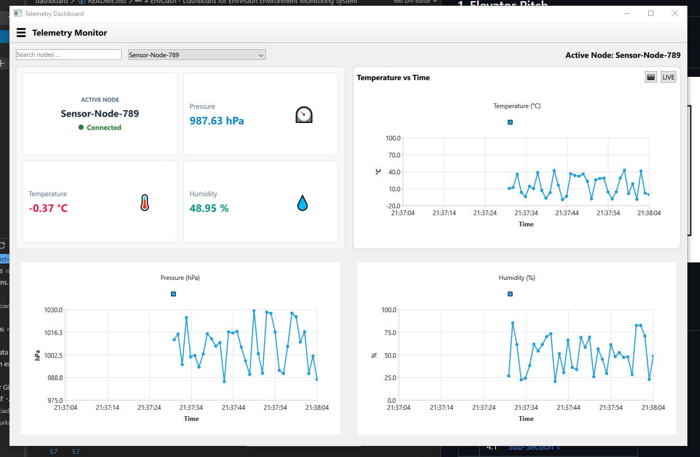
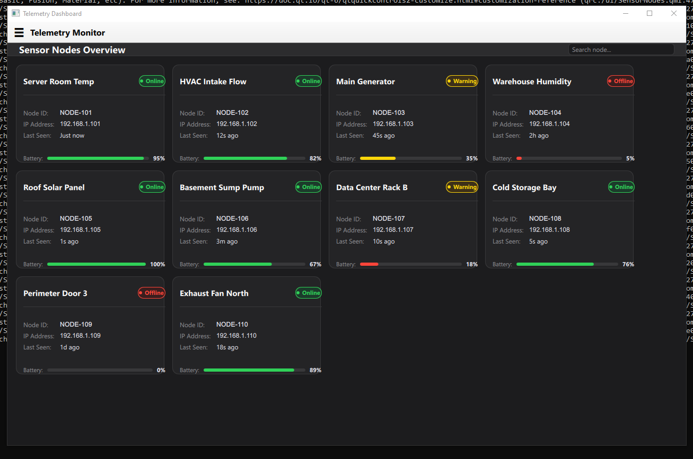
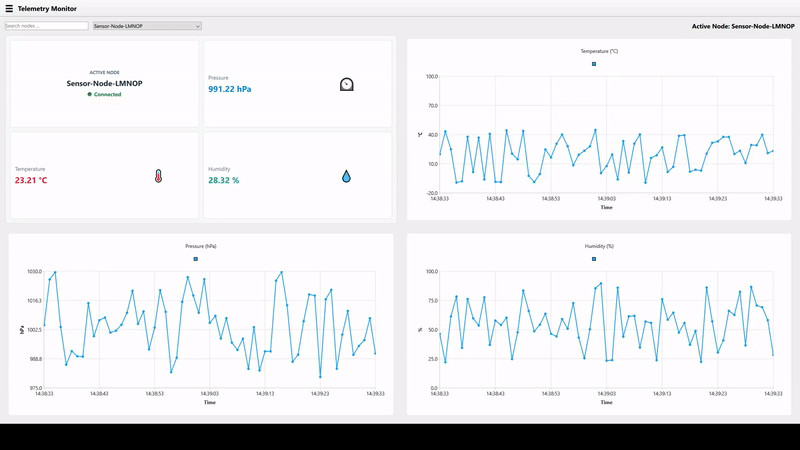

# EnvVision - Environment Monitoring System

<!-- Badges & Shields -->
[](https://en.cppreference.com/w/cpp/20)
[](https://www.qt.io/)
[](https://cmake.org/)
[](https://github.com/riciadavinci/EnvVisionEnvironmentMonitoringSystem/actions)
[](https://github.com/riciadavinci/EnvVisionEnvironmentMonitoringSystem/actions)
[](https://github.com/riciadavinci/EnvVisionEnvironmentMonitoringSystem/actions)
[](https://codecov.io/gh/riciadavinci/EnvVision-Environment-Monitoring-System)
[](LICENSE)


## 1. Overview

An end-to-end telemetry system designed for low-latency data acquisition and live visualization from a Raspberry Pi Pico 2 W (RP2350). The repository features a FreeRTOS firmware stack utilizing DMA, hardware interrupts, and lwIP over UDP, paired with cross-platform Qt6/QML desktop applications for real-time charting and hardware node mocking. Built modularly with decoupled CMake sub-projects, component-isolated CI/CD pipelines, and unified Codecov telemetry.

<br>

<p align="right"><sub>[&nbsp;<a href="#envvision---environment-monitoring-system">Back to Top</a> &nbsp;•&nbsp; <a href="#table-of-contents">Table of Contents</a>&nbsp;]</sub></p>

## 2. Gallery

<table>
  <tr>
    <td align="center">
      
      <br/>
      <sub><b>Figure 1:</b> Qt6/QML Desktop Dashboard Screenshot</sub>
    </td>
    <td align="center">
      
      <br/>
      <sub><b>Figure 2:</b> Sensor Nodes List</sub>
    </td>
  </tr>
</table>

<br>

<div align="center">
  
  <br/>
  <sub><b>Figure 3:</b> Live UDP Telemetry Graph (recorded with <i>OBS Studio</i>)</sub>
</div>

<br>

<p align="right"><sub>[&nbsp;<a href="#envvision---environment-monitoring-system">Back to Top</a> &nbsp;•&nbsp; <a href="#table-of-contents">Table of Contents</a>&nbsp;]</sub></p>

## Table of Contents
| # | Section |
|---|---|
| **1.** | [Overview](#1-overview) |
| **2.** | [Gallery](#gallery) |
| **3.** | [Project Directory Structure](#3-project-directory-structure) |
| **4.** | [Tech-Stack](#4-tech-stack) |
| **5.** | [System Architecture & Design Patterns](#5-system-architecture--design-patterns) |
|  | **5.1** &emsp;[Overview](#51-overview) |
|  | **5.2** &emsp;[Component: Dashboard - _EnvDash_](#52-component-dashboard---envdash) |
|  | **5.3** &emsp;[Component: Firmware - _EnvFirm_](#53-component-firmware---envfirm) |
|  | **5.4** &emsp;[Component: Mock Hardware - _EnvMock_](#54-component-mock-hardware---envmock) |
| **6.** | [Project Scope](#6-project-scope) |
|  | **6.1** &emsp;[Component: Dashboard - _EnvDash_](#61-component-dashboard---envdash) |
|  | **6.2** &emsp;[Component: Firmware - _EnvFirm_](#62-component-firmware---envfirm) |
|  | **6.3** &emsp;[Component: Mock Hardware - _EnvMock_](#63-component-mock-hardware---envmock) |

<br>

<p align="right"><sub>[&nbsp;<a href="#envvision---environment-monitoring-system">Back to Top</a> &nbsp;•&nbsp; <a href="#table-of-contents">Table of Contents</a>&nbsp;]</sub></p>

## 3. Project Directory Structure
```text
project-name/
├── .github/
│   └── workflows/                  # GitHub Actions workflows
│       ├── ci-dashboard.yaml
│       ├── ci-firmware.yaml
│       └── ci-mock_hardware.yaml
├── dashboard/                      # Component A: Dashboard
│   ├── dashboard_main.cpp
│   ├── src/
│   ├── tests/
│   │   └── CMakeLists.txt
│   └── CMakeLists.txt
├── firmware/                       # Component B: Firmware
│   ├── firmware_main.cpp
│   ├── src/
│   ├── tests/
│   │   └── CMakeLists.txt
│   └── CMakeLists.txt
├── mock_hardware/                  # Component C: Mock Hardware
│   ├── mock_hardware_main.cpp
│   ├── src/
│   ├── tests/
│   │   └── CMakeLists.txt
│   └── CMakeLists.txt
├── shared/                         # Shared Files (Network Packet Contracts, Protobuf, etc.)
└── codecov.yml                     # Codecov.io settings
```

<br>

<p align="right"><sub>[&nbsp;<a href="#envvision---environment-monitoring-system">Back to Top</a> &nbsp;•&nbsp; <a href="#table-of-contents">Table of Contents</a>&nbsp;]</sub></p>


## 4. Tech-Stack

### Overview/Shared
- Programming Language: C++ (C++20 standard), C++ Standard Library
- Testing & Code Coverage: Google Test, Google Mock, GCov, Codecov
- Linting & Sanitizers: Clang-Tidy, ASan, UBSan, TSan
- Build Tools: CMake 3.30.5, Ninja 1.31.1
- My custom deps/libs: 
    - Fixed Capacity Containers &emsp;([GitHub🔗](https://github.com/riciadavinci/fixed-capacity-containers))
    - sequelite-cpp &emsp;([GitHub🔗](https://github.com/riciadavinci/sequelite-cpp))

### Development Setup
- OS Tested on: Windows 10 & Ubuntu 26.04
- Compilers Tested on: 
    - Windows: MSVC 2022 (v19.41.34123 x64)
    - Linux: GCC & Arm GNU Toolchain

### Build Setup
- OS Tested on: GitHub Actions windows-latest & ubuntu-24.04
- Compilers Tested on:
    - Windows: MSVC 2022
    - Linux: GCC & Clang


<br>

<p align="right"><sub>[&nbsp;<a href="#envvision---environment-monitoring-system">Back to Top</a> &nbsp;•&nbsp; <a href="#table-of-contents">Table of Contents</a>&nbsp;]</sub></p>

## 5. System Architecture & Design Patterns

### 5.1 Overview

<!-- #### Architecture -->

<div align="center">

      <br/>
<sub><b>Figure:</b> Top-level System Architecture</sub>
</div>

### 5.2 Component: Dashboard - _EnvDash_

<div align="center">

      <br/>
<sub><b>Figure:</b> Component A - Dashboard (<i>EnvDash</i>) System Architecture</sub>
</div>

### 5.3 Component: Firmware - _EnvFirm_

<div align="center">

      <br/>
<sub><b>Figure:</b> Component B - Firmware (<i>EnvFirm</i>) System Architecture</sub>
</div>

### 5.4 Component: Mock Hardware - _EnvMock_

<div align="center">

      <br/>
<sub><b>Figure:</b> Component C - Mock Hardware (<i>EnvMock</i>) System Architecture</sub>
</div>

<br>

<p align="right"><sub>[&nbsp;<a href="#envvision---environment-monitoring-system">Back to Top</a> &nbsp;•&nbsp; <a href="#table-of-contents">Table of Contents</a>&nbsp;]</sub></p>


## 6. Project Scope

### 6.1 Component: Dashboard - _EnvDash_

The primary objective of **_EnvDash_** is to provide a real-time desktop interface for visualizing environmental sensor telemetry originating from hardware nodes (Pico 2 firmware) or simulated environments/mock hardware (Python).

#### In-Scope (v1.0 Deliverables)
- **Real-Time Telemetry Visualization:** Live rendering of temperature, humidity, and atmospheric metrics using Qt Quick / QML widgets and dynamic charts.
- **Multi-Transport Support:** Data ingestion over Serial (UART/USB) for physical hardware connections and IPC/Local Sockets for communication with the Python mock hardware simulator.
- **Hardware Status Monitoring:** UI indicators for connection state, packet loss, transmission frequency, and system threshold alerts.
- **Cross-Platform Target:** Build targets verified on both Windows (MSVC) and Linux (GCC & Clang) environments.
- **Multi-Threading & Async Programming:** Using QThreads for dedicated services (Telemetry Ingestion through QUdpSocket), local SQLite Telemetry logging, and Hardware Node Device Management. Using QtConcurrent for Asynchronous Database calls and I/O tasks to prevent freezing Main UI thread.
<!-- - **Configurable Dashboard Settings:** Controls enabling users to adjust sample rates, threshold triggers, and chart timeframes dynamically. -->

#### Out-of-Scope (v1.0 Non-Goals)
- **Cloud Storage & Remote Sync:** No direct backend cloud integration (AWS/Azure/GCP) or remote database persistence for v1.0; logging is handled locally.
- **Mobile / Web Platforms:** Exclusive focus on desktop environments (no iOS, Android, or WebAssembly targets).
- **User Authentication:** Single-user local desktop application without user login or permission roles.
- **Direct Firmware Flashing:** The application consumes telemetry streams only and does not perform OTA or direct firmware flashing to the microcontroller.

<br>

<p align="right"><sub>[&nbsp;<a href="#envvision---environment-monitoring-system">Back to Top</a> &nbsp;•&nbsp; <a href="#table-of-contents">Table of Contents</a>&nbsp;]</sub></p>

### 6.2 Component: Firmware - _EnvFirm_

#### In-Scope (V1.0 Deliverables)
- **Multi-State State Machine:** The Firmware will cycle through the following 3 States in that order: `DYNAMIC_DISCOVERY_STATE` ---> `TRANSITION_STATE` ---> `TELEMETRY_BROADCAST_STATE`.
- **Bare Metal & RTOS Combined:** The states `DYNAMIC_DISCOVERY_STATE` & `TRANSITION_STATE` will operate without _FreeRTOS_, while `TELEMETRY_BROADCAST_STATE` will make use of FreeRTOS Tasks for Reading Sensor Data, transmitting the telemetry & updating connected LCD 1602 Display.
- **Asynchronous Memory Copy:** Using DMA (Direct Memory Access) Controller Driver & ISR (Interrupt Service Routine) Driver to handle SPI Sensor Data reads asynchronously, enabling CPU to work on other tasks.
- **Low-level Network Programming:** Using _lwIP_ library to enable socket programming - [TCP Listener + UDP Broadcaster] during `DYNAMIC_DISCOVERY_STATE` and [UDP Broadcaster] during `TELEMETRY_BROADCAST_STATE`.

#### Out-of-Scope (V1.0 Deliverables)
- **No Dynamic Wifi/Network Credentials Store:** Local Wifi Credentials (SSID, Password) are flashed from Environment Variables during binary (`.elf`/`.uf2`) compilation. No mode to add Wifi SSID and Password dynamically.
- **No User Authentication:** User Authentication for authentication between the Sensor Node and Desktop Dashboard is absent.

<br>

<p align="right"><sub>[&nbsp;<a href="#envvision---environment-monitoring-system">Back to Top</a> &nbsp;•&nbsp; <a href="#table-of-contents">Table of Contents</a>&nbsp;]</sub></p>

### 6.3 Component: Mock Hardware - _EnvMock_

#### In-Scope (V1.0 Deliverables)
- **Total Firmware Imitation:** The Mock Hardware App will mimick `DYNAMIC_DISCOVERY_STATE` and `TELEMETRY_BROADCAST_STATE` states of the firmware, behaving exactly as the actual "Sensor Node".
- **Dynamic Node Management:** Dynamically add mock sensor nodes and manage their runtime (`DYNAMIC_DISCOVERY_STATE`, `TELEMETRY_BROADCAST_STATE`, `OFF_STATE`). Set minimum and maximum thresholds for Pressure, Temperature & Humidity values for each node. Dynamically induce faulty values for realistic operation.
- **Shared Data Source:** _EnvMock_ shares its `AppSettings.db` SQLite database with _EnvDash_, thus having single source for Sensor Node Data (post creation). Still requires "**confirmation**" from _EnvDash_ to register new sensor nodes, same as with the actual Firmware.

#### Out-of-Scope (V1.0 Deliverables)
- **No User Authentication:** User Authentication for authentication between the Sensor Node and Desktop Dashboard is absent.

<br>

<p align="right"><sub>[&nbsp;<a href="#envvision---environment-monitoring-system">Back to Top</a> &nbsp;•&nbsp; <a href="#table-of-contents">Table of Contents</a>&nbsp;]</sub></p>


